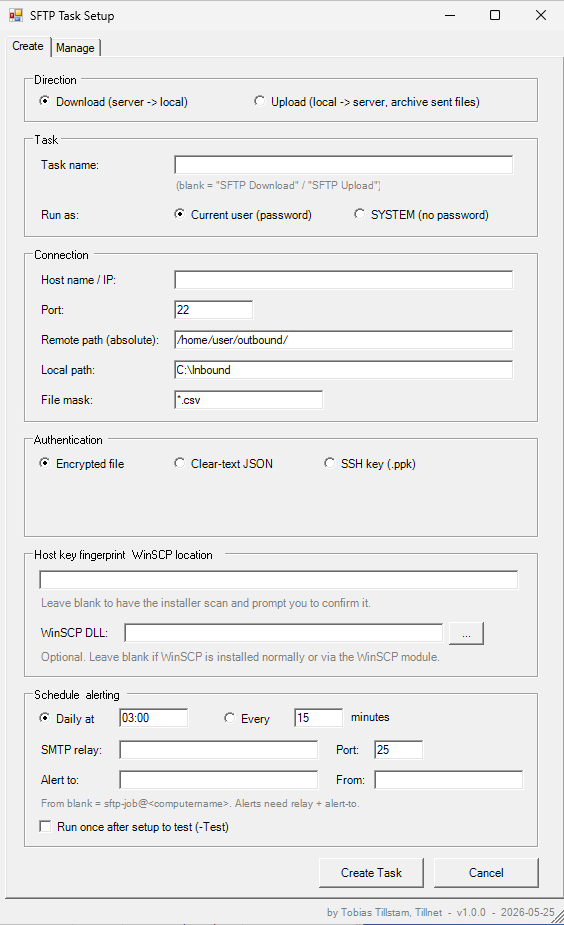

# SFTP Scheduled Task Toolset

> A PowerShell toolset for unattended SFTP file transfers on Windows, run as scheduled tasks. Includes a WinForms GUI for creating and managing transfer jobs.

[](LICENSE)


Built around the [WinSCP](https://winscp.net/) .NET assembly. Designed for sysadmins who need reliable scheduled SFTP transfers (downloads, uploads with local archive, or both), without writing a one-off script per server.

---

## Features

- **Bidirectional transfer** — download from or upload to an SFTP server.
- **Four authentication modes:**
  - DPAPI-encrypted credential file (default).
  - Clear-text JSON config (ACL-restricted; for cross-account or SYSTEM use).
  - SSH private key (`.ppk`).
  - Direct PSCredential (for interactive testing).
- **Run as the current user or SYSTEM**, with safety checks for incompatible combinations.
- **Per-task credentials and logs** — each task gets its own files, named after the task, so multiple tasks never clash.
- **GUI front-end** with Create and Manage tabs (list, run, edit-in-place, remove).
- **Email alerts** on failure (or partial failure) via an unauthenticated SMTP relay.
- **WhatIf/Confirm support**, host-key fingerprint scanning, configurable log retention.
- **Pure-ASCII source** — no encoding gotchas with PowerShell 5.1.

## Screenshot



## Requirements

- Windows with the desktop experience (for the GUI).
- PowerShell **5.1** or later.
- The WinSCP .NET assembly. Easiest install:

  ```powershell
  Install-Module -Name WinSCP -Scope AllUsers -Force
  ```

  Or download the WinSCP "Automation / .NET assembly" package from <https://winscp.net/> and either place `WinSCPnet.dll` in `C:\Program Files (x86)\WinSCP\`, or point the GUI's **WinSCP DLL** field at it.

- Administrator rights — the GUI self-elevates via a UAC prompt.

## Quick start (GUI)

1. Place all four `.ps1` files in the same folder (e.g. `C:\Scripts\SftpTaskToolset`).
2. Right-click `Install-SftpTask.GUI.ps1` → **Run with PowerShell** (or `powershell -ExecutionPolicy Bypass -File .\Install-SftpTask.GUI.ps1`).
3. Accept the UAC prompt.
4. On the **Create** tab, fill in the task name, host, paths, mask, auth mode, and schedule.
5. Click **Create Task**, confirm the SFTP credential in the console window.
6. Use the **Manage** tab to list, run, edit, or remove tasks later.

## Quick start (command line)

```powershell
.\Install-SftpTask.ps1 `
    -HostName 'sftp.example.com' `
    -RemotePath '/home/user/outbound/' `
    -LocalPath 'C:\Inbound' `
    -FileMask '*.csv' `
    -SshHostKeyFingerprint 'ssh-ed25519 256 ab:cd:...' `
    -DailyAt '03:00' `
    -RunAsSystem -UseClearTextConfig `
    -SmtpServer 'relay.corp.local' -EmailTo 'sftp-alerts@corp.local' `
    -Test
```

Run with `-WhatIf` first to see what would happen without changing anything.

## What gets created (per task)

| Thing             | Where                                                          |
| ----------------- | -------------------------------------------------------------- |
| Scheduled task    | Task Scheduler root (`\`), named as you chose.                 |
| Credential file   | `C:\ProgramData\SftpTaskToolset\<TaskName>.cred.xml` or `.config.json` |
| Log file          | `<toolset folder>\Logs\<TaskName>_yyyy-MM-dd.log`              |

## Authentication notes

- **Encrypted (DPAPI)** files can only be read by the same account on the same machine that created them. Don't use this mode for SYSTEM tasks.
- **Clear-text JSON** files are ACL-restricted (run-as account read, SYSTEM + Administrators full). Anyone with read access has the password.
- **SSH key** is the recommended option for SYSTEM tasks — no stored password at all. Convert OpenSSH keys to `.ppk` with PuTTYgen.
- The GUI blocks the incompatible **SYSTEM + encrypted** combination at the form.

## Troubleshooting

A few common issues, briefly:

- **Task fails with `0x1`, no other clue** — open `Logs/<TaskName>_<today>.log`; the last lines say what went wrong.
- **"No such file or directory"** on the remote — use the **absolute** path (e.g. `/home/user/outbound/`), not a relative one.
- **"Could not locate WinSCPnet.dll"** — install WinSCP (see Requirements), or point the GUI's WinSCP DLL field at it.
- **Manage tab doesn't show a task you know exists** — ensure the GUI is elevated; SYSTEM tasks aren't visible to non-elevated processes.

For more, see [README.txt](README.txt) (the operator's reference shipped alongside the scripts).

## Files

| File                          | Role                                          |
| ----------------------------- | --------------------------------------------- |
| `Install-SftpTask.GUI.ps1`    | WinForms front-end (start here).              |
| `Install-SftpTask.ps1`        | Scheduled-task installer.                     |
| `Get-SftpFiles.ps1`           | Download worker.                              |
| `Send-SftpFiles.ps1`          | Upload worker (with local archive).           |
| `README.md` / `README.txt`    | Documentation.                                |
| `CHANGELOG.md`                | Release history.                              |
| `LICENSE`                     | MIT license.                                  |

## Contributing

Bug reports and pull requests are welcome. When editing the `.ps1` files, save as **ASCII** or **UTF-8 with BOM** so PowerShell 5.1 reads them correctly. The scripts are intentionally pure-ASCII to avoid encoding surprises.

## License

[MIT](LICENSE) © Tobias Tillstam
